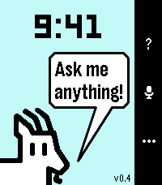

# Billy

Billy is a Gemini assistant for Pebble watches, forked from Bobby. Ask a
question or give a task by voice; Billy answers on the watch with short text
and Pebble-style cards (weather, timers, numbers, maps, pictures) and can act
on your phone and Google account.

No server is involved: requests go from your phone to Google with your own
Gemini API key.



## Watches

Pebble Time 2 (emery), Pebble Round 2 (gabbro), Pebble Time / Time Steel
(basalt), Pebble Time Round (chalk), Pebble 2 (diorite), Pebble 2 Duo (flint).
The original Pebble (aplite) has too little memory.

## Two ways to run

- **Watch app only** (iPhone or Android): install the PBW and paste a Gemini
  API key in its settings. Includes alarms, timers, timeline reminders,
  weather, maps, pictures, web search, a read-only calendar from iCal links,
  and memory.
- **With Billy Companion** (Android): adds Google Calendar, Tasks, Gmail,
  Drive/Docs, contacts, texts and calls, notifications and music, your phone's
  photos, navigation, and opening apps. Sending, calling and deleting always
  ask for confirmation on the watch.

## Setup

Everything runs on your own accounts; nobody has to invite you.

1. **Watch app:** install `Billy-x.pbw` from the
   [latest release](https://github.com/TomBolger/Billy/releases/latest) by
   opening it on your phone with the Pebble app.
2. **Gemini key (free):** go to https://aistudio.google.com/app/apikey, tap
   *Create API key* and copy it.
   - iPhone, or Android without the companion: paste it in Billy's settings
     in the Pebble app.
   - With Billy Companion: paste it in step 1 of the companion instead.
3. **Billy Companion (Android, optional):** install `BillyCompanion-x.apk`
   from the same release. Its screen lists each step with a button:
   Gemini key, phone access, Google account, memory.
4. **Google account (optional, about 10 minutes):** in Billy Companion tap
   *Set up Google*. It walks you through making your own free Google Cloud
   project (no card needed) with a button for every page, then signing in.
   Google will say the app isn't verified, because it's your own project:
   tap *Advanced*, then *Go to Billy (unsafe)*.
5. **Your Gemini account (optional, experimental):** card 5 in Billy
   Companion. Billy can then use what only the Gemini app knows: your Google
   Photos library, Gemini's saved info and past chats, Gems, Keep, YouTube
   and Google Home. The sign-in stays on the phone.

Personal context can also be imported as a Profile Pack; see
`docs/BILLY_PROFILE_PACK_TEMPLATE.md`.

## Building

GitHub Actions builds everything on each push (`.github/workflows/build-pbw.yaml`)
and publishes `Billy-dev.pbw` and `BillyCompanion-dev.apk` to the
`dev-<branch>` prerelease. Locally:

```powershell
cd app; pebble build                                  # app/build/app.pbw
cd companion-android; .\gradlew.bat assembleDebug     # app/build/outputs/apk/debug/
```

Tests: `node tools/pkjs-tests/agent.test.js`, `node tools/pkjs-tests/delivery.test.js`,
and `.\gradlew.bat testDebugUnitTest` in `companion-android`.

Store screenshots come from the emulator with scripted answers
(`.github/workflows/screenshots.yaml`); the results are in `store/screenshots/`.

### Google sign-in

Each user signs in through their own Google Cloud project with a "Desktop
app" OAuth client (loopback redirect with PKCE, see
`companion-android/.../auth/OwnGoogleProject.kt`). The older Android sign-in
under Advanced only works for testers added to the developer's project
(package `com.tombo.billyassistant.companion`, SHA-1
`1B:98:A8:38:72:6D:27:12:AA:25:3B:2B:AE:AF:BB:B3:8D:2F:16:1B`).

## Credits

Forked from Bobby / Tiny Assistant by the Rebble and Pebble community.
Developer: Thomas Bolger. Artwork: Sarah Bolger and Katherine Berry.
The dog photo in the store screenshots is a public-domain US Forest Service
photo (see `store/screenshots/CREDITS.txt`).

Apache 2.0; see `LICENSE`. Billy is not an official Google, Pebble, Core
Devices or Rebble product.
